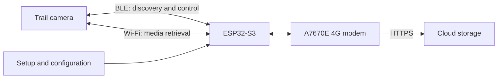
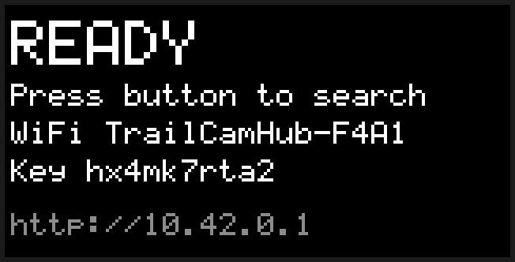
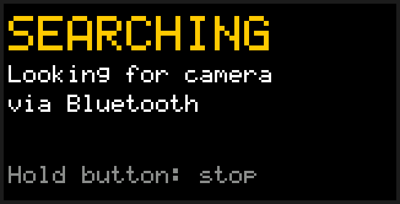
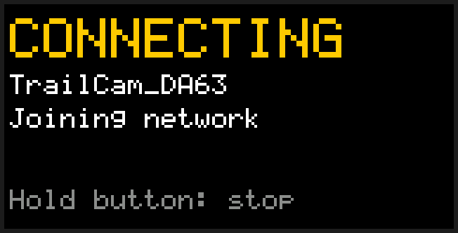
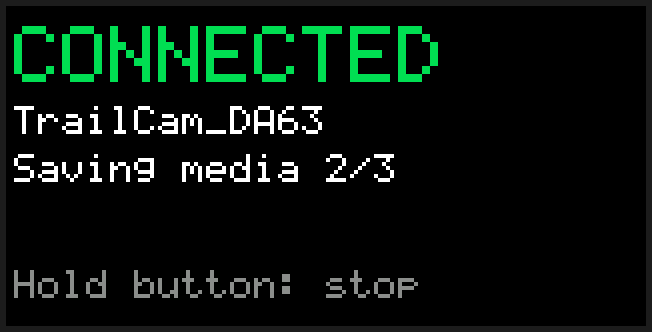
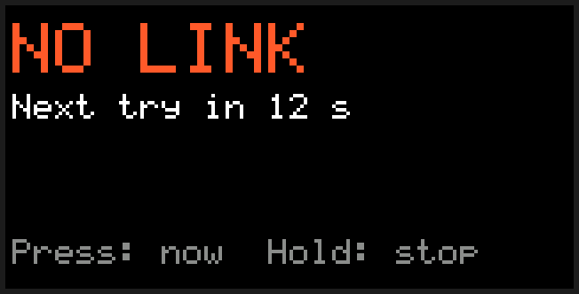
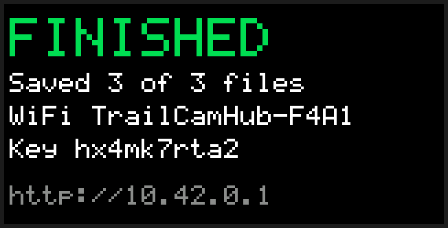
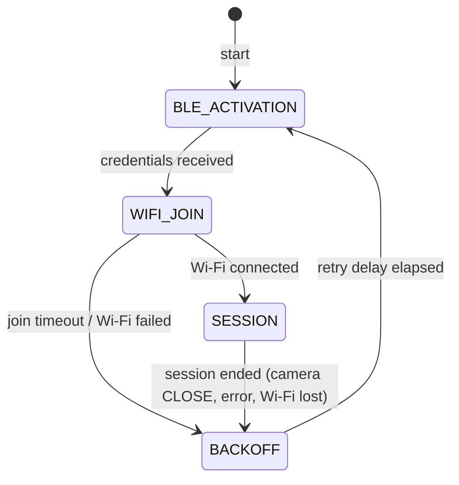

# TrailCamHub

An open-source trail camera bridge: an ESP32-S3 with an A7670E 4G modem is intended to retrieve media from supported trail cameras and transfer it to a configurable cloud storage service.

> **Status:** Concept / early draft. Hardware support, camera compatibility, wireless interoperability, and cloud integration have not yet been verified.

TrailCamHub aims to reproduce and automate the workflow of the **Trailcam Go** app for compatible cameras. The goal is interoperability with a camera owned by the user, not copying or distributing the proprietary app. TrailCamHub is an independent project and is not affiliated with Trailcam Go, its provider, or any camera manufacturer.

## Goals

1. Discover a camera in range and identify its available media.
2. Exchange control and connection information over Bluetooth Low Energy (BLE), where supported by the camera model.
3. Connect to the camera over Wi-Fi and download new photos and videos.
4. Buffer files locally and persist their upload status.
5. Transfer files to cloud storage over 4G using the A7670E modem.
6. Resume reliably after interruptions without losing files or creating unnecessary duplicate uploads.

## Proposed Architecture



The wireless links have different roles: BLE is expected to handle discovery and control, while Wi-Fi is intended for media retrieval. The cellular modem provides a separate internet uplink. Whether a specific camera follows this workflow depends on its model and firmware and must be verified first.

## Architecture Approach

The firmware should be divided into clearly separated components:

- **Camera discovery:** BLE scanning, supported-model identification, and connection status.
- **Camera adapter:** model-specific flows for authentication, Wi-Fi connection, file listing, and downloads. Shared functionality should remain separate from vendor-specific behavior.
- **Transfer queue:** a persistent list of discovered files with checksums, sizes, timestamps, and upload status.
- **Network manager:** manages the camera Wi-Fi connection and cellular uplink. Switching between these networks must not lose download or upload state.
- **Cloud adapter:** interchangeable upload destinations, initially over HTTPS. Credentials and endpoints should be configured rather than hard-coded in firmware.
- **Configuration and diagnostics:** secure setup of camera and cloud credentials, status reporting, and actionable error codes.

The firmware platform for the initial BLE proof of concept is ESP-IDF. The cloud destination will be selected after the board, modem interface, and initial camera protocols have been evaluated.

## Hardware and Open Questions

The target board is the **Waveshare ESP32-S3-A7670E-4G** development board. According to the [Waveshare documentation](https://docs.waveshare.com/ESP32-S3-A7670E-4G) it provides:

- ESP32-S3R8 with 512 KB internal SRAM, 8 MB in-package octal PSRAM, and 16 MB external flash
- A7670E LTE Cat-1/2G modem connected to the **native USB port of the ESP32-S3** (USB host, PPP), not to a UART. Because the ESP32-S3 has a single USB PHY, the firmware console uses UART0 through the board's USB-to-UART bridge. The bridge and the modem's USB share one USB-C port; DIP switches select which one is connected.
- microSD (TF) slot, wired to the SDMMC peripheral in 1-bit mode (CLK GPIO5, CMD GPIO4, D0 GPIO6, per the Waveshare Arduino examples)
- 18650 battery holder, solar charging input, and a MAX17048 battery fuel gauge on I2C
- DIP switches for camera, USB hub, and modem power; GNSS antenna connector; 24-pin camera connector

The firmware configuration (`sdkconfig.defaults`, `sdkconfig.defaults.esp32s3`, `partitions.csv`) targets this board: 16 MB flash, octal PSRAM, two 4 MB OTA application slots, a 64 KB core dump partition, and 64 KB NVS. Camera media is intended to be buffered on the SD card. Board revisions V1 and V2 differ in some GPIO assignments (camera and I2C); the SD card pins can be changed in `menuconfig` if a revision differs. Still to verify:

- Board revision, modem power-control GPIOs, and the USB host/PPP setup for the A7670E
- Power supply and cellular modem peak current requirements on battery
- Supported LTE bands, SIM format, and antenna connections for the deployment location
- ESP32-S3 BLE and Wi-Fi capabilities during simultaneous operation

A camera and a cellular subscription are required for testing. Camera credentials and SIM PINs must not be committed to the repository.

### Alternative board: Waveshare ESP32-P4-NANO (Ethernet uplink)

For installations with a wired network, the firmware can also be built for the **Waveshare ESP32-P4-NANO** (target `esp32p4`). Media is then meant to be transferred over Ethernet instead of the cellular modem. According to the [Waveshare documentation](https://www.waveshare.com/wiki/ESP32-P4-NANO) the board provides:

- ESP32-P4 with 32 MB in-package PSRAM and 16 MB external flash
- An on-board **ESP32-C6** co-processor for Wi-Fi 6 and BLE 5, connected over SDIO (SDMMC slot 1: CLK GPIO18, CMD GPIO19, D0-D3 GPIO14-17, C6 reset GPIO54). The ESP32-P4 itself has no radio.
- 10/100 Mbit/s Ethernet with an IP101 PHY on the on-chip EMAC (RMII, reference clock input GPIO50, MDC GPIO31, MDIO GPIO52, PHY reset GPIO51, PHY address 1); optional PoE module
- microSD slot on SDMMC slot 0 (4-bit, fixed pins CLK GPIO43, CMD GPIO44, D0-D3 GPIO39-42), powered by on-chip LDO channel 4
- Serial console on UART0 through the USB-to-UART port

`sdkconfig.defaults.esp32p4` adapts the common configuration to this board; the partition table is the same. Differences from the ESP32-S3 build:

- **Wi-Fi and BLE through ESP-Hosted.** The [`esp_wifi_remote`](https://components.espressif.com/components/espressif/esp_wifi_remote) and [`esp_hosted`](https://components.espressif.com/components/espressif/esp_hosted) components are added by the component manager for this target only (see `components/camera_wifi/idf_component.yml` and `components/camera_ble/idf_component.yml`). The `esp_wifi` API used by `camera_wifi` is forwarded to the ESP32-C6. NimBLE runs on the ESP32-P4 without a local controller and exchanges HCI packets with the C6 controller over the SDIO link (VHCI); `camera_ble` switches the C6 controller on before starting NimBLE and off again when it releases BLE. C6 firmware older than ESP-Hosted 2.5.2 does not support this request and keeps its controller enabled; the first request then times out after about 5 seconds, and the firmware stops switching the controller for the rest of the run. The ESP32-C6 must run the ESP-Hosted co-processor firmware of the same release as the host component.
- **C6 firmware update.** The `coprocessor_update` component builds the ESP-Hosted co-processor firmware for the ESP32-C6 from the `slave/` sources of the `esp_hosted` component (a nested `idf.py` build of a copy in the build directory, rebuilt only when the `esp_hosted` version changes) and embeds the image in the application. At boot the firmware asks the C6 for its version; if it differs from the embedded image, or the C6 does not answer, the image is sent over the ESP-Hosted link with the ESP-Hosted OTA API and the application restarts. A C6 that already runs ESP-Hosted 2.6 or newer is told to activate the image; older firmware switches on its own. Each image version is tried at most three times (**TrailCamHub PoC → Co-processor firmware** in `menuconfig`), so a C6 that cannot be updated this way does not cause a restart loop; it then has to be flashed over its UART (see the [ESP-Hosted documentation](https://github.com/espressif/esp-hosted-mcu)). The update can be disabled in the same menu, which also skips the C6 build.
- **Ethernet uplink.** The `ethernet_uplink` component starts the EMAC with the IP101 PHY at boot and requests an address over DHCP; link and address changes are logged. Its route priority is higher than that of the Wi-Fi station, so the Ethernet interface stays the default route while the camera access point is joined; the camera remains reachable through the directly connected camera subnet. `CONFIG_ESP_NETIF_SET_DNS_PER_DEFAULT_NETIF` keeps the DNS servers of the default interface, so the camera's DHCP server cannot replace them. The GPIOs and PHY address can be changed in `menuconfig` under **TrailCamHub PoC → Ethernet uplink**. Uploads themselves are not implemented yet, so a missing cable or failed Ethernet start is not fatal.
- **SD card** in 4-bit mode on SDMMC slot 0. The SDMMC host is shared with the ESP-Hosted transport on slot 1 and must not be deinitialized while ESP-Hosted is running.
- **PSRAM** in 16-line mode at the ESP-IDF default clock of 200 MHz.
- **Chip revision v1.x.** ESP32-P4 chips of revision v3.x need different firmware images than v0.x/v1.x chips, and ESP-IDF 5.5 builds for v3.x by default. `sdkconfig.defaults.esp32p4` selects revisions v1.0 to v1.99 instead, matching the boards in use; the boot log shows the chip revision. A board with a v3.x chip needs a separate build without `CONFIG_ESP32P4_SELECTS_REV_LESS_V3`.

Still to verify on hardware: ESP-Hosted transport and BLE scanning through the C6, camera Wi-Fi join and UDP session over `esp_wifi_remote`, simultaneous Wi-Fi and Ethernet operation, and the SD card in 4-bit mode next to the SDIO link.

### Alternative boards: LilyGO T-Dongle-S3 and T-Dongle-C5 (display and button)

The **LilyGO T-Dongle-S3** is a USB stick with an ESP32-S3 (16 MB flash, no PSRAM), a 0.96" ST7735 display (160x80), a button on the back (GPIO0, the BOOT button) and a microSD slot. It has no uplink of its own; it is meant for testing the camera workflow on the bench. The firmware is built for the `esp32s3` target with `sdkconfig.defaults.tdongle-s3` on top of the common defaults, which enables `CONFIG_BOARD_TDONGLE_S3` and adapts the configuration:

- **No automatic search.** `CONFIG_SESSION_AUTO_START` is off: after boot the dongle waits until the button is pressed. Failed attempts are still retried with the increasing delay until the user stops them; after a session that did all its work the dongle shows *FINISHED* instead of connecting to the camera again.
- **Button.** A short press starts the search for the camera (BLE scan, Wi-Fi enable, Wi-Fi join); during a retry delay it starts the next attempt at once. Holding the button for 1.5 s stops searching or ends the running session and returns to idle.
- **Display.** The `dongle_ui` component shows only the current phase: a coloured title (*READY*, *SEARCHING*, *CONNECTING*, *CONNECTED*, *NO LINK*, *FINISHED*), the camera Wi-Fi name once the camera has reported it, the download progress (*Saving media n/m*, *Saved n of m files*), the countdown to the next attempt, and a hint for the button; with the [web UI](#web-ui), the idle and finished screens also show its network name, password and address. Content is redrawn only when it changes. The screen content (`status_screen.cpp`) and its drawing (`screen_renderer.cpp`, `font5x7.cpp`) have no ESP-IDF dependencies and are host-tested.
- **No PSRAM.** PSRAM is disabled and the NimBLE host allocates from internal RAM.
- **Console** on the native USB port (USB-Serial-JTAG).
- **SD card** in 1-bit mode on CLK GPIO12, CMD GPIO16, D0 GPIO14, with the [log](#log-on-the-sd-card) on it.
- **Photo download** on (**Media download → Download photos to the SD card**, described with the other `menuconfig` options below); the UDP receive mailbox is raised to 16 packets so frames are not lost while the card is busy. The Base64 thumbnail is left out of the log (`CONFIG_CAMERA_THUMBNAIL_SERIAL_PREVIEW` off).

The display pins (MOSI GPIO3, SCLK GPIO5, CS GPIO4, DC GPIO2, RST GPIO1, backlight GPIO38, active low) are fixed in `components/dongle_ui/st7735_display.cpp`. The APA102 RGB LED (clock GPIO39, data GPIO40) shows a random colour at full brightness until it receives data, so `dongle_ui` switches it off when it starts (about a second after power-up). With `CONFIG_DONGLE_LED_BRIGHTNESS` (1-31, default 0 = off) it shows the phase in the colour of the display title instead, at that global brightness. Still to verify on hardware: display orientation and colours, and BLE plus Wi-Fi operation without PSRAM.

| | | |
|---|---|---|
|  |  |  |
|  |  |  |

The screenshots are drawn by `tools/dongle_screens` with the same rendering code as the firmware (`status_screen.cpp`, `screen_renderer.cpp`, `font5x7.cpp`); the network name and key are example values. After changing a screen, regenerate them with `cmake -S tools/dongle_screens -B build-screens && cmake --build build-screens && build-screens/dongle_screens docs/images/dongle`; CI fails if they are out of date.

The **T-Dongle-C5** ([LilyGO repository](https://github.com/Xinyuan-LilyGO/T-Dongle-C5), schematic `hardware/T-Dongle-C5 V1.1.pdf`) is built for the `esp32c5` target with `sdkconfig.defaults.tdongle-c5`, which enables `CONFIG_BOARD_TDONGLE_C5`. It behaves like the T-Dongle-S3, with these differences:

- **ESP32-C5HR8** (RISC-V, dual-band Wi-Fi 6, BLE 5) with 8 MB quad PSRAM in the package and 16 MB flash, so the common PSRAM settings stay on. The image requires chip revision v1.0 or later.
- **Button** on GPIO28.
- **Display** on MOSI GPIO2, SCLK GPIO6, CS GPIO10, DC GPIO3, RST GPIO1, backlight GPIO0 (active low); same panel, orientation and offsets as on the T-Dongle-S3.
- **SD card in SPI mode** (`CONFIG_SD_CARD_SPI_MODE`, forced because the ESP32-C5 has no SDMMC host). The card shares SPI2 with the display: SCK GPIO6, MOSI GPIO2, MISO GPIO7, CS GPIO23. The SD driver initializes the bus with a maximum transfer size large enough for a display frame and leaves it initialized when no card is found; the display driver then uses that bus (`sd_card_spi_bus_ready()`). The SPI driver serializes the transfers of both devices.
- **RGB LED** on clock GPIO4, data GPIO5.
- **Web UI** on (`CONFIG_WEB_UI_ENABLE`, see [Web UI](#web-ui)); its network name, password and address are on the idle and finished screens.
- **Video download** on (`CONFIG_CAMERA_DOWNLOAD_VIDEOS`, which needs PSRAM), in addition to the photos. The heartbeat interval during a video is 500 ms (`CONFIG_CAMERA_VIDEO_HEARTBEAT_INTERVAL_MS`), an experiment explained in [docs/video-download.md](docs/video-download.md).

Still to verify on hardware: the display next to the SD card on the shared bus, the web UI, and the photo download. The first boots (chip revision v1.0, 8 MB PSRAM, SD card mounted over SPI, BLE activation, camera Wi-Fi and thumbnails) and the video download (45 thumbnails and three videos in a row in one session, each 15-second video in about 37 s) have been checked.

### Web UI

With `CONFIG_WEB_UI_ENABLE` (**TrailCamHub PoC → Web UI** in `menuconfig`, off by default; not on the ESP32-P4) the `web_ui` component opens a WPA2 access point `TrailCamHub-XXXX` next to the camera station (AP+STA) and serves a page at `http://10.42.0.1`. Its password (10 characters from an alphabet without characters that look alike on a small display, such as `g`, `q` and `9`) is generated at the first boot and stored in NVS, and `web_ui_password()` returns it for a display; a stored password from an earlier firmware that contains such characters is replaced once; a fixed password can be set in `menuconfig`. The page shows the workflow status and the download progress, has buttons to search for the camera and to stop, browses the SD card (photos and videos with their thumbnails), shows images, videos, audio and text files, offers every file for download and deletion (two taps: *Delete*, then *Delete?* within three seconds) and follows the current log file of `sd_log` live. Directories, the log file being written and unfinished files (`.part`, `.tmp`) cannot be deleted, because removing a file that is open for writing corrupts the FAT volume. A deleted photo or video stays marked as downloaded in the catalog, so it is not downloaded again.

- The DHCP server offers no router, so phones keep their mobile data for the internet and reach the device on the local subnet.
- While the camera Wi-Fi is joined, the access point has to use the camera's channel. If it was on another channel, clients are disconnected when the station joins and usually reconnect within a few seconds. The component therefore stores the channel of the last camera in NVS and opens the access point there at the next boot, so with the same camera the switch happens only once. The channel scan while joining interrupts the access point for a moment but does not disconnect clients; a continuous BLE scan, however, leaves the access point little air time while the camera is searched.
- The HTTP server runs in one task, so the page does not update while a large file is being downloaded.
- The page consists of `index.html`, `style.css` (all layout) and `app.js` in `components/web_ui/www/`, embedded in the firmware. The path parameters are decoded and checked by `web_paths.cpp` (host-tested), which rejects `..` segments.
- It needs about 40 KB of internal RAM; boards without PSRAM may run short of memory for BLE and Wi-Fi.

### Log on the SD card

`sd_log` (enabled by default wherever the SD card is enabled, **TrailCamHub PoC → Log on the SD card**) copies every log line to `/sdcard/logs/log-NNNNN.txt`, so that a field test can be read afterwards without a serial console. The lines are collected from the first statement of `app_main` (the boot messages are kept in a 64 KB PSRAM buffer until the card is mounted; 8 KB of internal RAM without PSRAM) and written by a low-priority task about once per second; each write is synced to the card, so pulling the device loses at most the last second. A new file is started at every boot and when a file reaches 4 MB; the 50 newest files are kept. Lines that do not fit into the buffer, for example while the card is busy, are counted and noted in the file. Lines longer than 255 characters are cut.

## Compatibility and Protocol Investigation

Compatibility with cameras supported by Trailcam Go is a development goal, not a confirmed feature. First, investigate the normal connection flow and data formats for a specific camera model owned by the project team. Then implement a focused camera adapter and verify it using test media.

Protocol observations should be documented reproducibly without publishing credentials, private images, or personal data. TrailCamHub must not bypass security mechanisms. Verify compatibility, authorization, and applicable terms of use before testing.

### BLE Wi-Fi Activation PoC

For the PoC, firmware scans in 30-second windows for a connectable advertisement that matches a known camera name or advertises service UUID `0x8801`, and connects to the first match; unrelated nearby devices are not connected. The current name allowlist contains `TC100_ED3B`; a camera with another name is still found by its service UUID. Non-connectable advertisements are ignored. After connecting, the firmware logs the camera's complete GATT profile. The compatibility check requires service `0x8801` to include writable characteristic `0x0002` and notification/indication characteristic `0x0003` before the Wi-Fi-enable command is sent. Candidate filtering is only a fast pre-filter, not proof of compatibility. Scan and connection callbacks are serialized so failed connections do not trigger overlapping scans. These UUIDs were first reported for a Lutranstra PR5000-WF and have been confirmed with a TC100 camera.

The BLE implementation lives in the `camera_ble` component and uses the NimBLE host as a central/GATT client only (no pairing, one connection). `camera_ble.cpp` owns the NimBLE stack lifecycle, scanning, the connection and the GATT client sequence (services → characteristics → CCCD → Wi-Fi-enable write), `camera_ble_discovery.cpp` filters advertisements, and `camera_ble_protocol.cpp` parses the configured command and framed JSON responses and reports the credentials through a callback. The hardware-independent parts (`ble_advertising.cpp`, `ble_wifi_response.cpp`, `gatt_profile.cpp`, `hex_payload.cpp`) are covered by host tests. The NimBLE stack and the Bluetooth controller are only started while the camera is being activated. With **Release BLE after the camera Wi-Fi was activated** (enabled by default) the firmware disconnects from the camera and shuts BLE down once the credentials have arrived, which returns the stack's memory for the camera session; disable the option if a camera switches off its access point when the BLE connection ends. Camera names and advertised service UUIDs can be extended in the discovery module as additional models are investigated.

The default Wi-Fi-enable payload is ASCII `BT_KEY_ON` (`42 54 5F 4B 45 59 5F 4F 4E` in hex), based on the reported BLE command for enabling the camera's Wi-Fi. The firmware writes it to characteristic `0x0002` after discovering the configured service and characteristic. The UUIDs still need to be independently verified for the TC100.

The serial log also reports the camera's BLE address, address type, signal strength (RSSI), advertisement and scan-response bytes, discovered services and characteristics, and the properties and handles of those characteristics. For characteristics that support notifications or indications, the firmware subscribes. It reassembles the framed JSON response from characteristic `0x0003` and prints the response status, SSID, and BSSID. The Wi-Fi password is deliberately redacted; BLE packet contents for this response are not logged in hex because they contain credentials.

The Wi-Fi name cannot currently be predicted reliably from a BLE device name. A camera may derive an SSID suffix from an address or another device identifier, but that mapping has not been verified. Compare the SSID (for example, `TrailCam_897B`) with the BLE address and captured advertisement data from the serial log before assuming there is a stable relationship; BLE addresses may also be randomized.

### Camera Wi-Fi PoC

The camera Wi-Fi code is split into two components: `camera_wifi` manages the station lifecycle and reports Wi-Fi events, and `camera_link` implements the camera session. In `camera_link`, `pppp_session.cpp` is the reliable-UDP layer (DATA numbering, retransmission of unacknowledged DATA every 800 ms, acknowledgement and duplicate filtering of received DATA, ALIVE answers, CLOSE detection), `camera_protocol.cpp` implements discovery, PRE_LOGIN, and the ARTEMIS Hello and heartbeats on top of it, `camera_prelogin.cpp` builds the PRE_LOGIN plaintext, `camera_udp_packets.cpp` defines a shared `UdpRequest` interface and fixed-size request types for discovery, PRE_LOGIN, ARTEMIS commands, RUDP DATA/ACK, and handshake Magic packets, while `camera_udp_transport.cpp` owns UDP send/receive and packet-level TX/RX logs. `ArtemisCommandRequest` builds the ARTEMIS request header around an already encrypted and Base64-encoded payload; command-specific JSON, encryption, and commands such as login and file listing are not implemented yet. Packet framing follows the PPPP/CS2 P2P protocol: reliable DATA packets (`F1 D0`) carry a 16-bit index per channel, numbered consecutively from 0 in each session, and ACKs (`F1 D1`) list the acknowledged indices (`D1 00 <count:2> <index:2>...`), the same format the camera uses.

After a successful BLE Wi-Fi response, the firmware uses the returned SSID and password to join the camera access point. Credentials are kept in runtime memory only and are not logged or saved to NVS. Once connected, it binds its UDP socket to local port `35281` and sends the `LBCS` discovery packet to the Wi-Fi gateway on ports `40611` and `3333`. For up to 1.5 seconds it waits for a packet longer than four bytes, prefixed with `F1`, from that gateway; the reply's source port is then used for the AES-128-ECB/PKCS#7 encrypted `F9` PRE_LOGIN request containing the current Unix timestamp and a fresh 8-byte nonce. Queued discovery traffic is drained before PRE_LOGIN. After sending PRE_LOGIN, the firmware waits up to one second for an ARTEMIS `F1 D0` DATA packet from the camera, validates its RUDP header and declared length, and acknowledges its index. It then sends the ARTEMIS Hello (DATA index 0) and the two Magic handshake packets from the reference implementation, whose purpose is not yet understood. The camera's ALIVE packets (`F1 E0 00 00`, about every 1.1 seconds) are answered with ALIVE_ACK (`F1 E1 00 00`); without them the camera ends the session with CLOSE (`F1 F0 00 00`) after a few seconds, which the firmware logs before ending the session. The RUDP session sends heartbeat DATA packets every 1.5 seconds, waits for a matching ACK before sending the next heartbeat, and retransmits the current heartbeat with the same index after 800 ms if no matching ACK arrives. Valid DATA packets from the camera are acknowledged immediately. DATA payloads are not decrypted or processed; application login and file retrieval are not implemented. The 28-byte static header, key, request layout, handshake payloads, heartbeat contents, and RUDP DATA/ACK framing follow the experimental [pi_trailcam reference implementation](https://github.com/philibertschlutzki/pi_trailcam/blob/main/main.py); discovery, PRE_LOGIN, heartbeats, and ALIVE/CLOSE have been observed with a TC100 camera. The device clock must be set for the timestamp to be meaningful; firmware currently warns if it appears unset. Serial diagnostics include discovery target, UDP ports, complete hex data for outgoing and received UDP packets, elapsed time, and DATA/ACK indices; Wi-Fi disconnect reasons, RSSI, and BSSID are logged as well. Credentials are never logged.

The firmware uses the custom partition table in `partitions.csv` (16 MB flash, two 4 MB OTA slots, core dump partition). OTA update logic itself is not implemented yet. At boot the firmware logs the reset reason, the available PSRAM, whether a core dump from a previous crash is stored (read it with `idf.py coredump-info`), and mounts the SD card at `/sdcard` without ever formatting it; a missing card is not fatal. Free and minimum-ever free heap for internal RAM and PSRAM are logged at boot, after Wi-Fi and BLE start, when the camera Wi-Fi connects, and every 30 seconds (**Memory log interval** in `menuconfig`; 0 disables the periodic log).

Build and flash with ESP-IDF:

```sh
idf.py set-target esp32s3
idf.py menuconfig
idf.py build flash monitor
```

For the ESP32-P4-NANO, build in a separate directory so the ESP32-S3 build stays intact (the component manager downloads `esp_hosted` and `esp_wifi_remote` into `managed_components/` on the first build):

```sh
idf.py -B build-esp32p4 -D IDF_TARGET=esp32p4 \
    -D SDKCONFIG=build-esp32p4/sdkconfig build flash monitor
```

The VS Code task **ESP-IDF: Build ESP32-P4-NANO firmware** runs the same build.

For the T-Dongles, add the board defaults (the VS Code tasks **ESP-IDF: Build T-Dongle-S3 firmware** and **ESP-IDF: Build T-Dongle-C5 firmware** run the same builds):

```sh
idf.py -B build-tdongle-s3 -D IDF_TARGET=esp32s3 \
    -D SDKCONFIG=build-tdongle-s3/sdkconfig \
    -D SDKCONFIG_DEFAULTS="sdkconfig.defaults;sdkconfig.defaults.tdongle-s3" \
    build flash monitor

idf.py -B build-tdongle-c5 -D IDF_TARGET=esp32c5 \
    -D SDKCONFIG=build-tdongle-c5/sdkconfig \
    -D SDKCONFIG_DEFAULTS="sdkconfig.defaults;sdkconfig.defaults.tdongle-c5" \
    build flash monitor
```

If flashing fails, hold the button while plugging the dongle in to enter the download mode.

#### Project structure

The firmware is split into ESP-IDF components with explicit dependencies:

| Component | Responsibility |
|---|---|
| `main` | `app_main`: initializes storage, the network stack and the Ethernet uplink, and wires the components together |
| `components/camera_ble` | BLE scan and connection, GATT profile check, Wi-Fi-enable command, credential response |
| `components/camera_wifi` | Wi-Fi station for the camera access point; runs a session callback after each connection |
| `components/camera_link` | Camera session over UDP: discovery, PRE_LOGIN, PPPP/ARTEMIS packets, ALIVE, heartbeats; media list, thumbnails, photo and video download |
| `components/sd_storage` | microSD card mount |
| `components/ethernet_uplink` | Ethernet uplink with DHCP (ESP32-P4-NANO only) |
| `components/coprocessor_update` | Builds, embeds and installs the ESP32-C6 co-processor firmware (ESP32-P4-NANO only) |
| `components/dongle_ui` | Status display and search button (T-Dongle-S3 and T-Dongle-C5 only) |
| `components/web_ui` | Access point and web UI: status, search/stop, file browser and download, live log |
| `components/sd_log` | Copy of the log output in text files on the SD card |
| `components/diagnostics` | Reset reason, core dump status, and heap statistics |
| `components/session_controller` | Session state machine and the task that drives the camera workflow |

Components do not call each other directly. They report events through callbacks to the session controller, which runs them in one task:



BLE activation is paused while joining the camera Wi-Fi and during the session, and credentials that arrive later are ignored; by default the BLE stack is released at that point (see the BLE section). After a failure the controller leaves the camera network, waits, and activates the camera over BLE again. The retry delay starts at 5 seconds and doubles up to 60 seconds; it is reset once a session is reached. The Wi-Fi join timeout (30 seconds) and the retry delays are configurable in `menuconfig` under **TrailCamHub PoC → Session**. The pure state machine (`session_fsm.cpp`) is covered by host tests. Project options are defined in `main/Kconfig.projbuild` and appear in `menuconfig` under **TrailCamHub PoC**.

#### Host tests

Protocol parsing and packet construction do not depend on ESP-IDF and are unit-tested on the development machine with [doctest](https://github.com/doctest/doctest), including packets captured from a TC100 camera. No board or ESP-IDF installation is required:

```sh
cmake -S test/host -B build-host
cmake --build build-host
ctest --test-dir build-host --output-on-failure
```

Code in these hardware-independent files must not include ESP-IDF headers. New parsing or protocol logic should be placed in such files and covered by a test in `test/host`.

#### Build profiles

The firmware has two build profiles:

- **Development** (default): `idf.py build` uses only `sdkconfig.defaults`. It keeps ESP-IDF's debug-friendly optimization level and INFO logging, including the complete camera UDP packet contents. This is the profile flashed by the browser installer.
- **Release**: adds `sdkconfig.defaults.release`, which optimizes for size, silences assertion messages, and removes INFO/DEBUG log statements and Bluetooth stack logs at compile time. Use it to judge the binary size and RAM headroom of the firmware.

Build the release profile in its own build directory so it does not disturb the incremental development build:

```sh
idf.py -B build-release -D IDF_TARGET=esp32s3 \
    -D SDKCONFIG=build-release/sdkconfig \
    -D SDKCONFIG_DEFAULTS="sdkconfig.defaults;sdkconfig.defaults.release" \
    build size
```

The VS Code task **ESP-IDF: Build release firmware and show size** runs the same command. Profile-independent settings belong in `sdkconfig.defaults`; size-related settings that hinder debugging belong in `sdkconfig.defaults.release`.

#### GitHub Codespaces build environment

The repository's [Dev Container configuration](./.devcontainer/devcontainer.json) uses the same `espressif/idf:v5.5.6` image as the firmware CI workflow, sets `IDF_PATH` to `/opt/esp/idf`, and mounts the repository at `/project`. Keeping this mount point stable is important: CMake records absolute source and build paths in `build/CMakeCache.txt`. If a Codespace previously built the project from another path, the existing cache can no longer be used from that different path.

To apply the Dev Container configuration to an existing Codespace, run **Codespaces: Rebuild Container** from the VS Code Command Palette (`Ctrl+Shift+P` / `Cmd+Shift+P`). If that command is not available, use **Dev Containers: Rebuild Container**. This rebuilds the Codespace container; it does not delete the repository's `build/` directory. After reconnecting, verify the environment from the integrated terminal:

```sh
printf 'IDF_PATH=%s\n' "$IDF_PATH"
idf.py --version
```

`IDF_PATH` should be `/opt/esp/idf`, and the ESP-IDF version should be 5.5.6. Build the firmware with the default VS Code build task **ESP-IDF: Build firmware** (`Ctrl+Shift+B`) or run this command from the repository root:

```sh
idf.py build
```

For a fresh checkout, select the target once before the first build:

```sh
idf.py set-target esp32s3
```

The `build/` directory is intentionally ignored by Git and should be kept between builds for incremental compilation. The generated `sdkconfig` is also local and ignored; project defaults belong in the tracked `sdkconfig.defaults`. Do not routinely delete `build/` or run `idf.py fullclean`. The stable `/project` mount avoids cache path mismatches across Codespace restarts/rebuilds. If the ESP-IDF image/version or target changes, follow ESP-IDF's documented reconfiguration process for that change rather than clearing the build directory as a routine step.

In `menuconfig`, open **TrailCamHub PoC**. **Wi-Fi enable payload (hex)** defaults to the bytes for ASCII `BT_KEY_ON`; spaces, colons, and hyphens may separate hex bytes. Set the option to an empty string to inspect GATT profiles without writing. The PoC uses a GATT write with response when supported by the characteristic. **Log camera UDP packet contents as hex** (enabled by default) logs every sent and received camera UDP packet in 16-byte hex lines below its one-line summary; disable it to reduce serial output. **Print the first thumbnail of a session as Base64** (enabled by default) logs the first thumbnail of each session between `THUMB` markers for the browser installer's live view; boards that keep the log on the SD card or show the thumbnails otherwise can disable it to save about 33 KB of log per session.

**Media download → Download photos to the SD card** (off by default) downloads, after the thumbnails, every photo of the media list that the catalog does not mark as downloaded yet: cmdId 1285 requests the file, which streams back on bulk subtype 0x03 and is written to `/sdcard/<camera-id>/media/<dir>_<num>.<ext>` while it arrives (`BulkStream` on top of `FrameReorder`, with a reorder window of 32 frames in PSRAM or 8 without, so a photo is never held in RAM). The data goes to a `.part` file that is renamed when complete; the extension is taken from the content (JPEG, MP4/MOV, AVI, otherwise `bin`). A file without data for 20 seconds is dropped and tried again in the next session; a failed SD write stops the downloads. `camera_protocol_set_progress_callback()` reports the progress, for example to a display. Videos are not offered by cmdId 1285: the camera acknowledges the request but sends no data. **Download videos** (off by default, needs PSRAM) fetches them like the TrailCam Go app does, by playback (cmdId 769), and stores the streams as `<dir>_<num>.h264` (plays in VLC) and `<dir>_<num>.aac`; `ffmpeg -framerate 25 -i 100_2.h264 -i 100_2.aac -c copy 100_2.mp4` makes an MP4 without re-encoding (25 frames per second on the camera tried so far). Protocol, implementation and what to look for in the log are described in [docs/video-download.md](docs/video-download.md); several videos have been received completely in a row on one camera, a 15-second video in about 37 s (see the notes there).

The **Firmware Package** GitHub Actions workflow builds the firmware for every board and publishes a `trailcamhub-<board>` artifact (`esp32s3`, `esp32p4`, `tdongle-s3`, `tdongle-c5`) containing a merged flash image, the individual firmware images, checksums, and deployment instructions. The default CI build uses the development profile, includes the `BT_KEY_ON` Wi-Fi-enable payload, and sends it after GATT discovery. The workflow also builds the release profile and writes a size report to the run summary: total image size, free space in the application partition, and memory use per component. On pull requests it adds a size comparison against the target branch and warns when less than 10 % of the application partition remains free. Separate jobs run the host unit tests and check C/C++ formatting with `clang-format` 23 against the repository's `.clang-format`; run `git ls-files '*.cpp' '*.h' '*.hpp' | xargs clang-format -i` before committing.

### Browser Installer and Serial Console

The GitHub Pages site provides a browser-based firmware installer and serial console:

**https://thomaspohl.github.io/TrailCamHub/**

The installer uses [ESP Web Tools](https://esphome.github.io/esp-web-tools/) to flash the merged ESP32-S3 image. The image and manifest are published together on GitHub Pages by the **Firmware Package** workflow after a push to `main`. Pull requests build the deployment package but do not publish the site. The installer reflects the latest successful deployment from `main`; it is not a version-pinned release installer. To enable the deployment the first time, open the repository's **Settings → Pages** and select **GitHub Actions** as the build and deployment source. The workflow then publishes the page automatically.

Use a desktop Chromium-based browser with Web Serial support, such as current Google Chrome or Microsoft Edge. Open the HTTPS installer page, connect the ESP32-S3 using a USB data cable, select its serial port, and confirm the browser's install prompt. Close or finish the installer before opening the serial console; then click **Connect to serial output**, choose the board's port, and view ESP-IDF logs at 115200 baud. Browser serial access requires explicit permission and may not be available in other browsers or on mobile devices.

The manual merged image and its SHA-256 checksum are also available on the installer page. Alternatively, download the `trailcamhub-esp32s3` artifact from a successful GitHub Actions run and follow its deployment instructions.

The installer does not configure the camera name or Wi-Fi-enable payload. It installs the default CI build, which sends `BT_KEY_ON` to request Wi-Fi activation after BLE discovery. Do not install firmware unless you trust its source, and use the installer only with a board you are authorized to modify.

## Reliability and Security

- Mark files as locally available only after a successful download and a reasonable integrity check.
- Make uploads idempotent and resumable after power or network failures.
- Store credentials securely on-device and never include them in logs.
- Encrypt cloud connections and validate certificates correctly.
- Bound storage usage and define when successfully transferred files may be deleted locally.
- Make errors and diagnostics useful for maintaining a device without a display.

## Development Milestones

1. Verify the board revision, pinout, power supply, and modem interface.
2. Select a supported camera and document its BLE/Wi-Fi workflow using test data.
3. Verify the BLE-controlled camera Wi-Fi connection and initial API requests on a supported camera.
4. Enable a single media download with an integrity check.
5. Add a persistent queue and resumable uploads.
6. Connect an initial HTTPS cloud adapter and run end-to-end tests.
7. Expand setup, diagnostics, camera support, and security features.

## Roadmap: adoption and setup simplification

The firmware flow is coming together; the larger open question is how hard this is
for someone else to actually deploy. Flashing is already easy (the web installer),
but the surrounding steps are still "advanced hobbyist". These are the planned
improvements, roughly in order of how much they lower the barrier:

- **Runtime configuration instead of recompiling (highest impact).** Provision the
  device without a toolchain: a first-boot Wi-Fi access point ("TrailCamHub-Setup")
  with a small config page (cellular APN, cloud/relay URL + secret, wake interval,
  camera selection), or — even better — write the same config over Web Serial
  directly from the existing web installer, so "flash + configure" is one browser
  flow. One binary then serves every user.
- **Camera compatibility is the first gate.** Only cameras from the supported
  (ARTEMIS/PPPP) family work. Publish a **compatibility matrix** and add a
  **"does my camera work?" diagnostic mode** as the very first step, so an
  incompatible camera is surfaced up front rather than as a late frustration.
- **Cloud relay as a copy-paste template.** Prefer a small relay (e.g. a Google
  Apps Script web app: one HTTPS POST → Drive folder + Sheet row, plus a
  command endpoint for the downlink) over putting Google OAuth/keys on the device.
  Ship it as a copy-paste template with screenshots for users; keep `clasp` as the
  developer path. Secrets live in Script Properties, never in the repo.
- **Sane defaults and modes.** Ship a "thumbnails + metadata only" default (cheap,
  winter-friendly), with full photo/video transfer opt-in, so a newcomer has to
  decide almost nothing.
- **Quickstart with a bill of materials and a wiring diagram.** A concrete parts
  list and a wiring picture remove most of the hardware uncertainty.
- **Downlink by polling on wake.** Since the device sleeps, a return channel works
  as a command queue the device reads on each wake (e.g. "fetch full video X",
  "change interval", OTA), rather than a persistent connection.

Realistic target: with runtime config, a copy-paste cloud template, and a
compatibility list, end-to-end setup moves from "1–3 h for a tinkerer" toward
"~30 min for a technically-minded user", with the genuinely hard constraints
(camera compatibility, cellular SIM) made visible up front.

## Contributing

Contributions are welcome. During this early phase, verified information about board revisions, camera models, and reproducible connection steps is especially useful. Do not submit private media, credentials, or firmware images obtained without authorization.

## License

This project is licensed under the Apache License 2.0. See [LICENSE](LICENSE).
